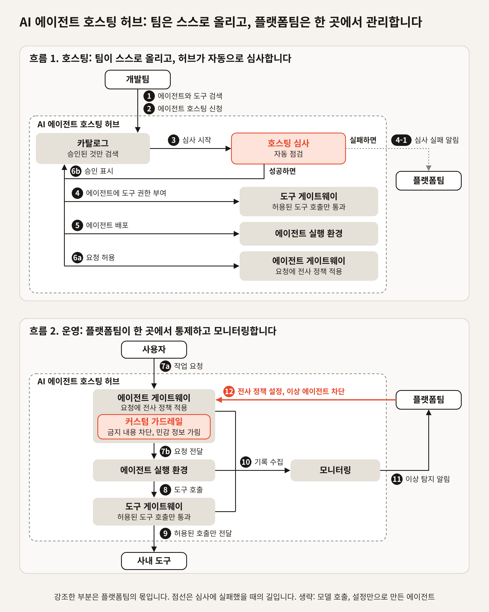
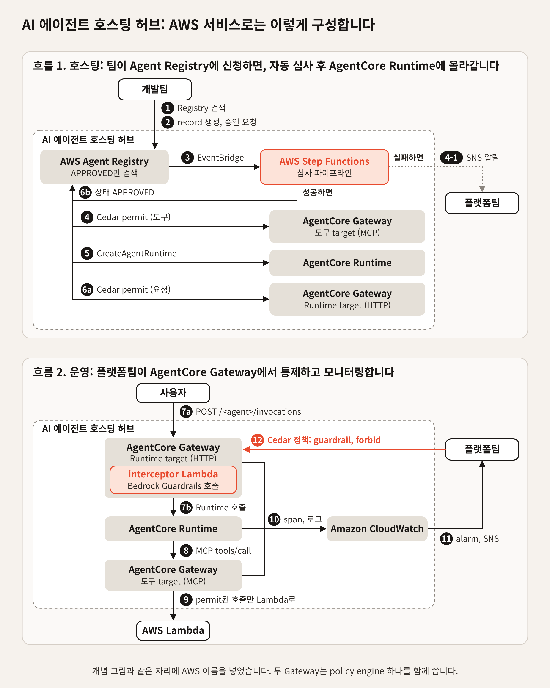
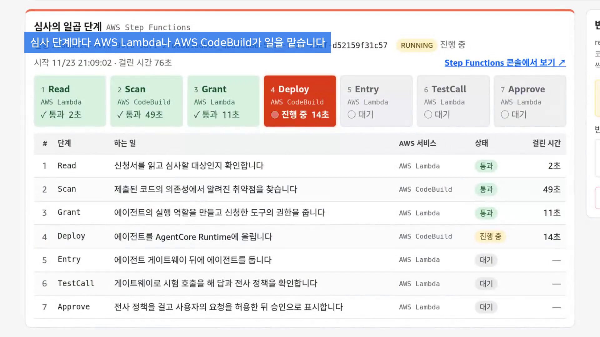

# AI Agent Hosting Hub

[한국어](README.md) | English | [Demo video (YouTube, in Korean)](https://youtu.be/cp0YKgAmrxM)

This is a short English version of the Korean [README.md](README.md), with the same sections. The detailed pages under `docs/`, the other READMEs, the pictures and the video are in Korean only (the hub screen has an English switch).

This repository builds a hub on Amazon Bedrock AgentCore where the AI agents of several development teams are hosted and managed in one place.
The platform team builds the hub (gateways, policies, catalog); the development teams build agents and put them on the hub.
Policies are written in Cedar, and the hub decides which agent may use which tool.

> The repository holds two flows. Flow 1 is hosting (application, review, approval, rejection and re-application). Flow 2 is operations (the company policy's log-only and enforce modes, the custom guardrail, a new version of an approved agent, the tool-call alarm (CloudWatch alarm), stopping and resuming one agent, the usage report, and two agents that are there from the start). Both flows have a script that checks them from end to end on real AWS (`make e2e`, `make e2e-ops`).

[](docs/hosting-hub-concept.png)

The concept picture draws the two flows as boxes and numbered arrows. Flow 1 (hosting) is ① to ⑥; flow 2 (operations) is ⑦ to ⑫.

[](docs/hosting-hub-system.png)

The system picture puts AWS service names in the same places as the concept picture. For example, ⑤ is "에이전트 배포" (deploy the agent) in the concept picture and `CreateAgentRuntime` in the system picture. Both pictures are in Korean only. The description of each folder is in [Structure and code](docs/architecture.md).

## The video

[](https://youtu.be/cp0YKgAmrxM)

The full video with the narration (15 minutes 16 seconds; narration and captions in Korean) is on YouTube: <https://youtu.be/cp0YKgAmrxM>. Clicking the picture above opens it too.

A video that demonstrates the hub was recorded on 2026-11-23. There is a full video (10 minutes 50 seconds) and five videos, one per stage (55 seconds to 3 minutes 31 seconds), and the picture above is one frame of the full video.

- Preparation: the hub screen's home.
- Stage 1: Claude Code on the developer PC finds the shared tools in the catalog's MCP server and makes the files of the agent `quality_agent` from the standard template (it does not run or upload them), and the developer applies for the agent `release_review` and the vulnerable version of the agent `quality_agent`.
- Stage 2: the hosting reviews of the two applications run automatically, so that the agent `quality_agent` stops at Scan and the agent `release_review` passes the seven steps, is approved and answers, and the platform team writes a reason and rejects, and the fixed version is approved.
- Stage 3: the company policy `guard_prompt` is set in log-only mode, and a request that holds an instruction to the agent is not blocked and is counted once in the tally.
- Stage 4: when the mode is raised to enforce, the same request gets 403 from both agents, `release_review` and `docs_adk`, and it shows how a request with a code name and an answer with an employee ID differ before and after the custom guardrail is attached.
- Stage 5: a version that repeats its tool call passes the review but does not answer, and the tool-call alarm goes off; only that one agent is stopped and its neighbors answer. Claude Code reads the logs and the code and points to the cause, the fixed version is approved while still stopped, and after it is resumed it answers again.

The video file is not in this repository. The sources of the video are in `demo_video/`: the storyboard of each scene, the editing script that holds every caption (`demo_video/scripts/build.py`), and the developer PC (`demo_video/tools/dev_pc`). How the video is made is in [`demo_video/README.md`](demo_video/README.md). The hub the video was recorded on was deleted afterwards. Putting the hub up and checking it (`make deploy`, `make e2e`, `make e2e-ops`) needs neither this folder nor `demo_scenes/`.

On 2026-11-24 the same six videos were made a second time with a Korean narration (an Amazon Polly voice) and red highlight boxes (the full video is 15 minutes 16 seconds). The narration says only what the screen shows or what a README of this repository states. The red boxes are on the hub's pages and on Claude Code's screen, where they surround 29 of the places the narration points at. The scenes in the developer's shell and the user's shell have none. These videos are not in the repository either. Of them, the full video is on YouTube (the link at the top of this section). How they are built, their checks and the limits of those checks are in [`demo_video/README.md`](demo_video/README.md) (in Korean). The person who built them did not listen to the sound.

## Quick start

You need Terraform 1.9 or later, Python 3.12 or later with uv, AWS credentials, the Region `us-west-2` and access to the Amazon Bedrock model. The details are in [Getting started](docs/getting-started.md).

```bash
cp .env.example .env   # the hub's three values: region, prefix, model
make deploy            # deploys the hub's base resources; about 4 minutes in an empty account
make seed              # puts the shared tool record into the catalog and approves it; 6 seconds
make preload           # puts up the two preloaded agents; about 11 minutes
make ui                # starts the hub screen (sample) on this PC: http://127.0.0.1:8300
make destroy           # deletes everything the hub made; 9 to 18 minutes, by the number of agents
```

- **Cost**: the hub keeps no server running, and most of the charge follows use (number of calls, run time, stored data). When you are done, delete it with `make destroy`. [Cost and cleanup](docs/cost-and-cleanup.md)
- **Like the video**: to go through the video's steps by hand in your own account, see [Follow the video by hand](docs/demo-guide.md).
- **Checks**: to check both flows from end to end, run `make e2e` and `make e2e-ops`. [What was checked](docs/checks.md)

## What is in it

The folders are split by who uses them. Below is the structure opened two levels deep. The description of each folder and the links to each README are in [Structure and code](docs/architecture.md).

```text
agent-hosting-hub/
├── Makefile              # make deploy, seed, preload, e2e, e2e-ops, destroy and more ("Seven commands" in docs/getting-started.md)
├── .env.example          # the hub's three values: region, prefix, model
│
├── platform_team/        # platform team: the hub's base resources and the operations commands; one folder per feature
│   ├── terraform/        #   root module: brings the feature folders' terraform/ together in one apply
│   ├── shared_code/      #   code several features share (settings, AWS calls, the code package)
│   ├── agent_catalog/    #   catalog (AWS Agent Registry): applying, searching, registering shared tools
│   ├── hosting_review/   #   hosting review (Step Functions, Lambda, CodeBuild) and rejection
│   ├── agent_gateway/    #   agent gateway and the command that calls an agent
│   ├── tool_gateway/     #   tool gateway
│   ├── sample_tools/     #   sample in-house tools (synthetic data)
│   ├── company_policy/   #   company policy: Cedar templates, policy engine, rollout.sh
│   ├── custom_guardrail/ #   custom guardrail: interceptor Lambda, guardrail.sh
│   ├── agent_monitoring/ #   alerts, the tool-call alarm, the usage report (usage.sh), reading logs
│   ├── agent_stop/       #   stopping and resuming one agent (stop.sh, resume.sh)
│   ├── dev_access/       #   the development team's role
│   └── hub_ui/           #   hub screen (sample, on this PC only)
│
├── dev_team/             # development team: the template and example agents
│   ├── agent_template/   #   standard template and the upload command (publish.sh)
│   ├── release_review/   #   example agent (LangGraph)
│   ├── quality_agent/    #   example agent (Strands); variants/ holds two versions made for the demo
│   └── preloaded_agents/ #   the two preloaded agents (docs_adk, spec_assistant)
│
├── docs/                 # the two pictures and the detailed pages ("Read more" below; in Korean)
├── e2e_checks/           # check scripts that run on real AWS; spikes/ is a record of checked assumptions
├── tests/                # unit tests; they make no AWS call
├── demo_scenes/          # the four commands typed in the video's terminal (ask, publish, search, logs)
└── demo_video/           # what makes the video: storyboards, the recording script, captions and cuts (build.py), the developer PC
```

## Read more

These pages are in Korean.

| Document | Contents |
|---|---|
| [Getting started](docs/getting-started.md) | Requirements, `.env`, the seven commands and how long they took, the two preloaded agents |
| [Commands](docs/commands.md) | The operations commands, the hub screen (sample), the commands typed in the video |
| [What was checked](docs/checks.md) | What `make e2e` and `make e2e-ops` check, the dates of the runs and what was seen |
| [Cost and cleanup](docs/cost-and-cleanup.md) | The resources that cost money, what `make destroy` deletes and what it leaves |
| [Known limits](docs/limits.md) | The limits of this sample |
| [Structure and code](docs/architecture.md) | The two pictures, the description of each folder, a walk through the code |
| [Follow the video by hand](docs/demo-guide.md) | A guide to go through the video's steps by hand in your own account |
| [What makes the video](demo_video/README.md) | Storyboards, recording, captions and cuts, the developer PC |
| [Commands typed in the video](demo_scenes/README.md) | `ask`, `publish`, `search`, `logs` and the order of the scenes |
| [The documents before they were shortened](https://github.com/gonsoomoon-ml/agent-hosting-hub/tree/docs-detailed-2026-11-25) | The earlier version, with every run's measured times and what each run showed (tag `docs-detailed-2026-11-25`). The documents were shortened on 2026-11-25 |
