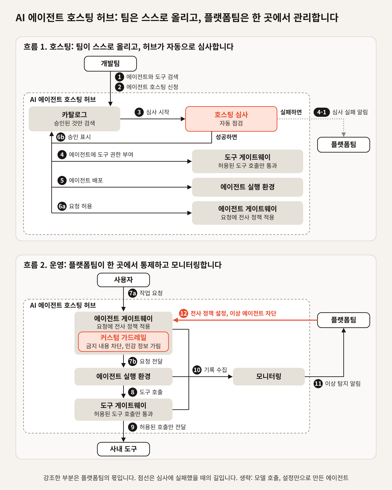
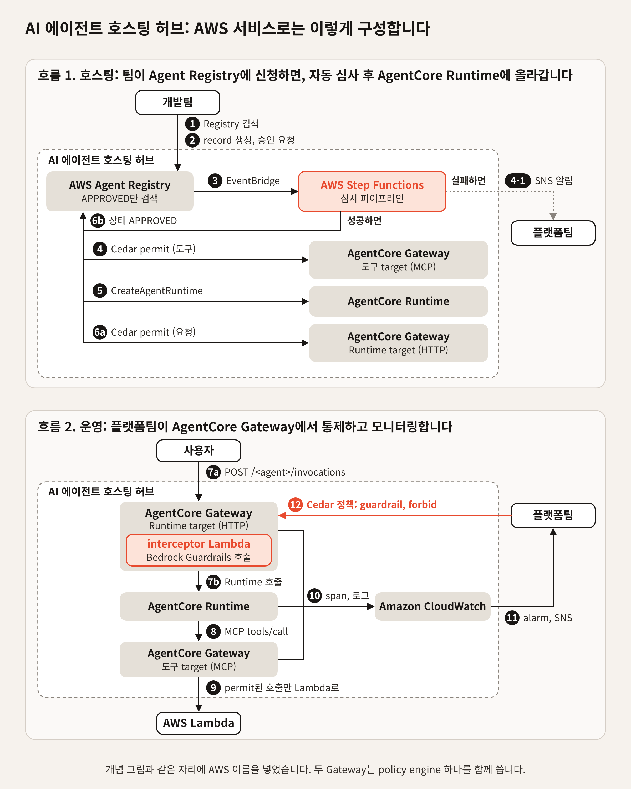

# 구조와 코드

[README](../README.md)로 돌아가기

허브의 그림 둘, 폴더마다 들어 있는 것, 흐름이 지나가는 코드를 적습니다. 폴더의 트리는 [README](../README.md#무엇이-들어-있나)에 있습니다.

## 그림 둘

개념도는 두 흐름을 상자와 번호 붙은 화살표로 그립니다. 흐름 1(호스팅)은 ①부터 ⑥까지이고, ④-1은 심사가 실패했을 때의 길입니다. 흐름 2(운영)는 ⑦부터 ⑫까지입니다. ⑥은 6a와 6b로, ⑦은 7a와 7b로 나뉩니다. 각 기능의 README는 "개념도에서의 위치"에서 자기 상자와 번호를 가리킵니다.

구성도는 같은 자리에 AWS 서비스의 이름을 넣은 것입니다. 예를 들어 ⑤는 심사의 배포 단계가 부르는 `CreateAgentRuntime`입니다. 두 그림은 한국어로만 있고, 원본 파일은 이 저장소에 없습니다.

## 폴더마다 들어 있는 것

| 폴더 | 누가 쓰나 | 내용 |
|---|---|---|
| `platform_team/` | 플랫폼팀 | 허브의 기반 자원과 운영 명령. 기능마다 폴더가 하나입니다: [게이트웨이 둘](../platform_team/agent_gateway/README.md)([도구 쪽](../platform_team/tool_gateway/README.md)), [전사 정책](../platform_team/company_policy/README.md), [카탈로그](../platform_team/agent_catalog/README.md), [호스팅 심사](../platform_team/hosting_review/README.md), [샘플 사내 도구](../platform_team/sample_tools/README.md), [모니터링](../platform_team/agent_monitoring/README.md), [개발팀의 권한](../platform_team/dev_access/README.md), [커스텀 가드레일](../platform_team/custom_guardrail/README.md), [에이전트 멈추기와 재개](../platform_team/agent_stop/README.md), [허브 화면](../platform_team/hub_ui/README.md)(샘플) |
| `dev_team/` | 개발팀 | [에이전트 템플릿](../dev_team/agent_template/README.md)과 올리는 명령(`publish.sh`), 예시 에이전트 [release_review](../dev_team/release_review/README.md)(LangGraph)와 [quality_agent](../dev_team/quality_agent/README.md)(Strands). `preloaded_agents/`에는 플랫폼팀이 `make preload`로 올리는 [미리 올려 둔 에이전트 둘](getting-started.md#미리-올려-둔-에이전트-둘)이 있습니다: [docs_adk](../dev_team/preloaded_agents/docs_adk/README.md)(Google ADK), [spec_assistant](../dev_team/preloaded_agents/spec_assistant/README.md)(코드가 없는 managed harness) |
| `e2e_checks/` | 누구나 | 실제 AWS에서 돌리는 확인 스크립트: `e2e_hosting.py`(흐름 1), `e2e_operations.py`(흐름 2), `check_platform.py`(허브의 기반 자원), `check_cleanup.py`(지운 뒤 남은 것). `spikes/`는 만들면서 가정을 확인한 기록입니다([확인 테스트](../e2e_checks/spikes/README.md)) |
| `tests/` | 누구나 | 단위 테스트(`make test`). AWS를 부르지 않습니다. |

## 예시 에이전트 넷

넷은 프레임워크가 모두 다릅니다. 허브는 프레임워크와 상관없이 같은 방식으로 에이전트를 올리고 통제합니다.

| | [quality_agent](../dev_team/quality_agent/README.md) | [release_review](../dev_team/release_review/README.md) | [docs_adk](../dev_team/preloaded_agents/docs_adk/README.md) | [spec_assistant](../dev_team/preloaded_agents/spec_assistant/README.md) |
|---|---|---|---|---|
| 프레임워크 | Strands (ReAct) | LangGraph (고정 흐름) | Google ADK | AgentCore managed harness (코드 없음) |
| 하는 일 | 검사 결과, 부품 사양 | 릴리스 규칙 위반 판단 | 사내 설계 표준 | 부품 사양, 시험 결과 |
| 허브의 도구 | `Quality`, `Parts`의 둘 | `Release`의 하나 | 없음(`[]`) | `Parts`의 둘 |
| 올리는 길 | `publish.sh`, 심사 | `publish.sh`, 심사 | `make preload`, 심사 | `make preload`, 심사를 건너뜁니다 |
| 진입 통제 | 받습니다 | 받습니다 | 받습니다 | 받지 않습니다(진입 target 없음) |

코드가 있는 셋의 `main.py`와 `hub_tools.py`는 [에이전트 템플릿](../dev_team/agent_template/README.md)의 복사본입니다.

## 코드 따라 읽기

흐름 1(호스팅)의 첫 두 단계가 지나가는 코드입니다. 번호는 위 [개념도](hosting-hub-concept.png)의 번호입니다.

**① 에이전트와 도구 검색.** 개발자가 카탈로그에서 승인된 레코드를 찾습니다. `demo_scenes/search`가 `platform_team/agent_catalog/search_catalog.py`를 부르고, 검색은 `platform_team/agent_catalog/catalog_records.py`의 `search_records()`가 합니다. 승인되지 않은 레코드는 나오지 않습니다.

**② 에이전트 호스팅 신청.** `dev_team/agent_template/publish.sh`가 `platform_team/agent_catalog/publish_agent.py`의 `publish()`를 부르고, `publish()`가 차례로 다음을 합니다.

- 검사: `platform_team/agent_catalog/application_form.py`의 `validate()`가 신청서(`agent.json`)를 검사합니다.
- 묶기: `bundle()`이 폴더 맨 위의 `.py` 파일과 `requirements.txt`를 zip으로 묶고, `publish()`가 그것을 제출 버킷에 올립니다. 변형을 주면 `variants/<변형>/`의 파일이 폴더의 파일을 대신합니다.
- 레코드 쓰기: `catalog_records.py`의 `put_record()`가 신청서를 카탈로그의 레코드로 씁니다.
- 승인 요청: 같은 파일의 `submit()`이 승인을 요청합니다. 레코드를 쓴 뒤의 상태가 `DRAFT`일 때만 요청하므로, 바뀐 것이 없는 재신청은 다시 요청하지 않습니다.

레코드가 `PENDING_APPROVAL`이 되면 `platform_team/hosting_review/terraform/main.tf`의 `aws_cloudwatch_event_rule.on_submit`이 호스팅 심사를 시작합니다.
